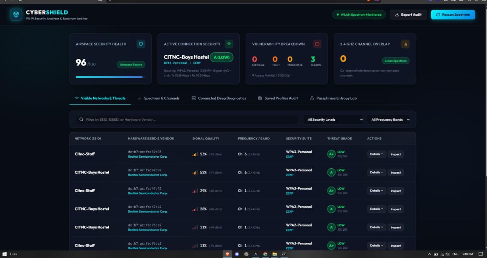
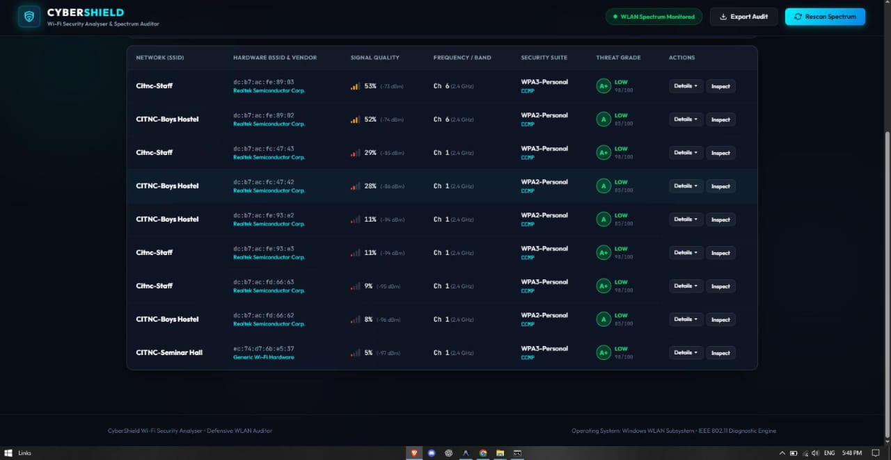

# 🛡️ NetGuard — Wi-Fi Cybersecurity Platform & Spectrum Auditor

[](https://www.python.org/)
[](https://flask.palletsprojects.com/)
[](https://www.sqlite.org/)
[](https://www.microsoft.com/)
[](LICENSE)

An enterprise-grade, high-performance **Wi-Fi Security Analysis, Spectrum Auditor, and Threat Assessment Platform** built with **Python (Flask)** and a responsive modern web dashboard.

NetGuard audits wireless access points, evaluates encryption protocols against modern cybersecurity standards (NIST, CIS, Wi-Fi Alliance), detects potential Evil-Twin and Rogue AP attacks, discovers connected devices with an authorized allowlist, measures ICMP latency and jitter, provides an AI security assistant, and generates downloadable audit reports.

---

## 🌟 Key Features

### 1. 🛰️ Deep Wi-Fi Spectrum & Access Point Scanner
- **Real-Time Airspace Discovery**: Discovers all visible SSIDs, BSSIDs (hardware MACs), signal strengths (percentage and calculated dBm RSSI), frequency bands (2.4 GHz, 5 GHz, 6 GHz), and Wi-Fi channels.
- **Hardware Vendor Resolution (OUI)**: Resolves MAC prefixes to device manufacturers (Intel, Realtek, Cisco, Ubiquiti, TP-Link, Netgear, Apple, Samsung, etc.).
- **Cryptographic Suite Auditing**: Flags Open/Unencrypted networks, deprecated WEP RC4 ciphers, legacy WPA1/TKIP, standard WPA2-CCMP, and modern WPA3-SAE (Simultaneous Authentication of Equals).
- **Search, Filter & Sorting**: Dynamically sort networks by signal, score, channel, band, or SSID with instant search filtering.

### 2. 🚨 Threat Detection & Evil Twin Radar
- **Evil Twin Identification**: Flags duplicate SSIDs operating on disparate BSSIDs with conflicting security standards or suspicious RSSI variances.
- **Rogue AP Detection**: Detects unauthorized access points advertising network configurations identical to authorized infrastructure.
- **Spectral Anomaly Detection**: Statistical Z-score heuristic analysis across observable radio spectrum parameters.

### 3. 🛡️ Dynamic Wi-Fi Security Score (0–100)
- **Objective Grading**: Computes an airspace and network security score based on encryption strength, authentication ciphers, PMF compliance, and rogue presence.
- **Classification Categories**:
  - 🟢 **Excellent (90–100)**: WPA3-Personal/Enterprise with PMF
  - 🔵 **Good (75–89)**: Robust WPA2-AES/CCMP
  - 🟡 **Moderate (50–74)**: Weak signal, legacy settings, or channel congestion
  - 🟠 **Poor (30–49)**: WPA/TKIP or mixed legacy modes
  - 🔴 **Critical (<30)**: Open broadcast or deprecated WEP

### 4. 💻 Connected Device Intelligence & Allowlist
- **Subnet Device Discovery**: Probes authorized network subnets using ARP and ICMP table analysis.
- **Device Fingerprinting**: Displays IP address, MAC address, hostname, and manufacturer vendor.
- **Trusted Hardware Allowlist**: 1-click toggling (`/api/devices/{id}/trust`) to approve known hardware and highlight untrusted or rogue devices.

### 5. ⚡ Network Performance, Latency & Jitter
- **ICMP Ping Telemetry**: Active round-trip time (RTT) measurements yielding minimum, maximum, and average latency.
- **Jitter & Packet Loss**: Measures connection variance and packet loss percentage to calculate a **Connection Quality Score (0–100)**.
- **Live Bandwidth Telemetry**: Captures real-time RX/TX upload and download rates via system network interface counters (`netstat -e`).

### 6. 🤖 AI-Powered Cybersecurity Assistant & Chat
- **Interactive Security Chat**: Ask natural-language questions about your Wi-Fi environment, encryption types, or threat alerts.
- **Tailored Remediation**: Explains identified risks in simple terms and provides router hardening advice without external cloud dependencies.

### 7. 🔑 Wi-Fi Password Extraction & Offline QR Code
- **Connected Credential Recovery**: Direct retrieval of the connected Wi-Fi password with **Show / Hide** and **1-Click Copy** buttons.
- **QR Code Sharing**: Integrated offline QR code generator (`/qrcode.js`) for rapid mobile connection without revealing plaintext passwords.

### 8. 📋 Router Hardening Checklist & Knowledge Base
- **Hardening Checklist**: Step-by-step guidance on disabling WPS, updating firmware, changing default credentials, and isolating guest networks.
- **Threat Intelligence & Tip of the Day**: Curated cybersecurity articles covering Evil Twin attacks, PMF (802.11w), and WPA3 dragonfly handshakes.

### 9. 📄 Multi-Format Export & Reporting
- **RFC-4180 CSV Export**: Complete scan table download for spreadsheet analysis.
- **Structured JSON Audit**: Full system audit state export for compliance and archival.
- **Printable PDF Security Report**: Dedicated `@media print` layout and modal preview for generating executive audit reports.

---

## 🏗️ Architecture & Project Structure

```
Wi-Fi-Security-Analyser/
├── app.py                                 # Flask REST API, SQLite Controller & Static Server
├── scanner.py                             # Native Windows Wi-Fi, Ping, Throughput & ML Engine
├── requirements.txt                       # Lightweight Python dependencies (Flask)
├── run.bat                                # 1-Click Windows launcher script
├── app.js                                 # Frontend state, charts, and API bindings
├── index.html                             # Responsive cybersecurity single-page application
├── styles.css                             # Dark/light theme styles & print formatting
├── qrcode.js                              # Offline QR code generator library
├── screenshots/
│   ├── dashboard.png.jpeg                 # Dashboard UI preview
│   └── networks.png.jpeg                  # Network analysis preview
└── README.md                              # Documentation
```

---

## 🚀 Getting Started

### Prerequisites
- **Operating System**: Windows 10 or 11
- **Python**: Python 3.8 or higher (Python 3.10–3.13 tested)
- **Wi-Fi Interface**: Enabled wireless adapter

### Installation & Launch

#### Option A: 1-Click Launcher (Windows)
Double-click `run.bat` in File Explorer or run:
```powershell
.\run.bat
```

#### Option B: Standard Python (Command Line)
```powershell
# 1. Install dependencies
pip install -r requirements.txt

# 2. Run the platform
python app.py
```

Once running, navigate to:
👉 **[http://127.0.0.1:5001](http://127.0.0.1:5001)**

---

## 📸 Screenshots

### 🛡️ Real-Time Cybersecurity Dashboard
<p align="center">
  
</p>

### 📡 Spectrum Analysis & Access Point Audit
<p align="center">
  
</p>

---

## 🔌 API Endpoints Reference

| Category | Method | Endpoint | Description |
| :--- | :--- | :--- | :--- |
| **Auth** | `POST` | `/api/auth/register` | Register new analyst account |
| **Auth** | `POST` | `/api/auth/login` | Authenticate user & generate bearer session token |
| **Auth** | `POST` | `/api/auth/logout` | Terminate session & invalidate token |
| **Auth** | `GET` | `/api/auth/profile` | Current user profile & authentication status |
| **Dashboard** | `GET` | `/` | Web UI Dashboard |
| **Dashboard** | `GET` | `/api/dashboard` | Active Wi-Fi telemetry, stats, connected password, and threats |
| **Scanning** | `POST`| `/api/scans/start` | Trigger live Wi-Fi scan session with full DB logging |
| **Scanning** | `GET` | `/api/scans` | Historical scan sessions |
| **Scanning** | `GET` | `/api/scans/{id}` | Granular AP observations for specific scan session |
| **Scanning** | `GET` | `/api/wifi/networks` | Visible access points with channel, band, RSSI, and security score |
| **Analysis** | `POST`| `/api/security/analyze`| Runs rule-based security findings engine |
| **Analysis** | `GET` | `/api/security/findings`| Filterable security findings log (severity/status) |
| **Analysis** | `GET` | `/api/security/score` | Current network security score with delta comparison |
| **Threats** | `GET` | `/api/threats` | Active threat analysis, Evil Twin detection, and rogue AP alerts |
| **Threats** | `POST`| `/api/threats/analyze`| Record threat events with confidence levels to database |
| **Threats** | `GET` | `/api/threats/history`| Historical threat event logs |
| **Devices** | `GET` | `/api/devices` | Subnet device inventory with vendor resolution |
| **Devices** | `POST`| `/api/devices/discover`| Trigger active ARP discovery & track presence |
| **Devices** | `POST`| `/api/devices/{id}/trust`| Toggle device hardware allowlist trust status |
| **Devices** | `GET` | `/api/devices/history` | Historical device connection logs |
| **Performance**| `GET` | `/api/performance` | Live latency, jitter, packet loss %, and quality score |
| **Performance**| `POST`| `/api/performance/test` | Execute performance audit & store to history |
| **Performance**| `GET` | `/api/performance/history`| Time-series latency and quality score history |
| **AI Assistant**| `POST`| `/api/ai/chat` | AI cybersecurity assistant chat endpoint |
| **AI Assistant**| `GET` | `/api/ai/recommendations`| AI executive summary & router hardening guidance |
| **ML Module** | `GET` | `/api/ml/anomalies` | Statistical Z-score & spectral anomaly detection |
| **Traffic** | `GET` | `/api/traffic` | Real-time byte transfer rates (RX/TX KB/s) |
| **Alerts** | `GET` | `/api/alerts` | Security alert event log with severity filtering |
| **Alerts** | `POST`| `/api/alerts/clear` | Mark all alerts as read |
| **Alerts** | `PATCH`| `/api/alerts/{id}/read`| Mark specific alert as read |
| **Alerts** | `POST`| `/api/alerts/{id}/ack` | Acknowledge critical alert |
| **Reports** | `POST`| `/api/reports/generate`| Generate PDF/CSV/JSON audit report & save metadata |
| **Reports** | `GET` | `/api/reports` | List generated security reports |
| **Reports** | `GET` | `/api/reports/{id}/download`| Download generated report payload |
| **Export** | `GET` | `/api/export/csv` | RFC-4180 CSV export download |
| **Export** | `GET` | `/api/export/json` | Complete structured JSON audit export |
| **Checklist** | `GET` | `/api/security/checklist`| Router security hardening rules |
| **Knowledge** | `GET` | `/api/knowledge` | Tip of the Day & cybersecurity threat intelligence |

---

## 🧪 Automated Testing

NetGuard includes a complete automated test suite covering all 18 functional modules:

```powershell
python tests/test_system.py
```

Expected result:
```text
=====================================================================
 TOTAL TESTS: 39 | PASSED: 39 | FAILED: 0
=====================================================================
>>> 100% OF ALL SYSTEM & INTEGRATION TESTS PASSED! APPLICATION FULLY FUNCTIONAL. <<<
```

---

## 🔑 Default Administrator Credentials

For initial testing and role-based access:
- **Username**: `admin`
- **Password**: `Admin@NetGuard2026!`
- **Role**: `administrator`

---

## 🔒 Security & Privacy Notice

NetGuard runs strictly in user mode on your authorized local hardware:
- Passwords are recovered only for profiles already authorized and saved on the local Windows device.
- Subnet scans are restricted to the local network gateway subnet.
- No telemetry, keystrokes, or scan data are uploaded to third-party cloud services.

---

## 📄 License

This project is licensed under the MIT License — see the LICENSE file for details.
